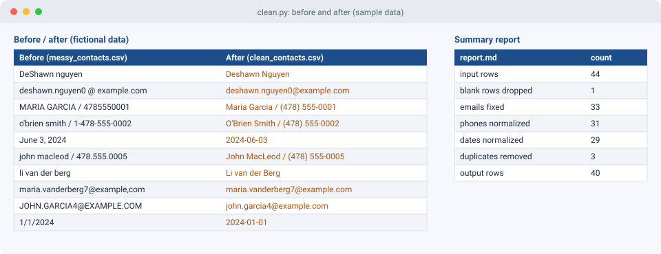

# Messy CSV Cleanup Tool

A sample project that takes a messy contact list and cleans it up: names, emails, phone numbers, dates, blank rows and duplicates. It writes a clean CSV and a short before/after report. The input data is generated and fictional.



## Problem
Exports from forms, CRMs and old spreadsheets are full of inconsistencies: ALL CAPS names, emails with spaces or a comma instead of a dot, phones in six formats, and dates written every way possible. That makes mail merges, imports and dedupes fail.

## Features
- Names: proper case, with handling for O'Brien, McDonald/MacLeod, hyphenated names and "van der".
- Emails: trims spaces, lowercases, fixes `,com`, and flags anything still invalid.
- Phones: normalizes US numbers to `(478) 555-0001`, strips a leading 1, and blanks junk like "n/a".
- Dates: reads `3/4/2025`, `2025-03-04`, `04-Mar-2025` and `March 4, 2025`, and outputs ISO `YYYY-MM-DD`.
- Drops blank rows and dedupes on the cleaned email.
- Writes `output/report.md` with counts and a before/after table.

## Usage
```bash
python make_messy.py                         # creates samples/messy_contacts.csv
python clean.py samples/messy_contacts.csv   # -> output/clean_contacts.csv + output/report.md
pytest -q
```
No third-party packages are needed to run it (pytest only for tests).

## Sample output
```
input rows           44
blank rows           1
duplicates removed   3
output rows          40
```

## Known limits
Name casing is rule-based, so a name like "DeShawn" written in all lowercase becomes "Deshawn". For a real job I would keep an exceptions list, or leave names alone when they already have mixed case.

## Tech stack
Python 3 standard library (csv, re, datetime), pytest
